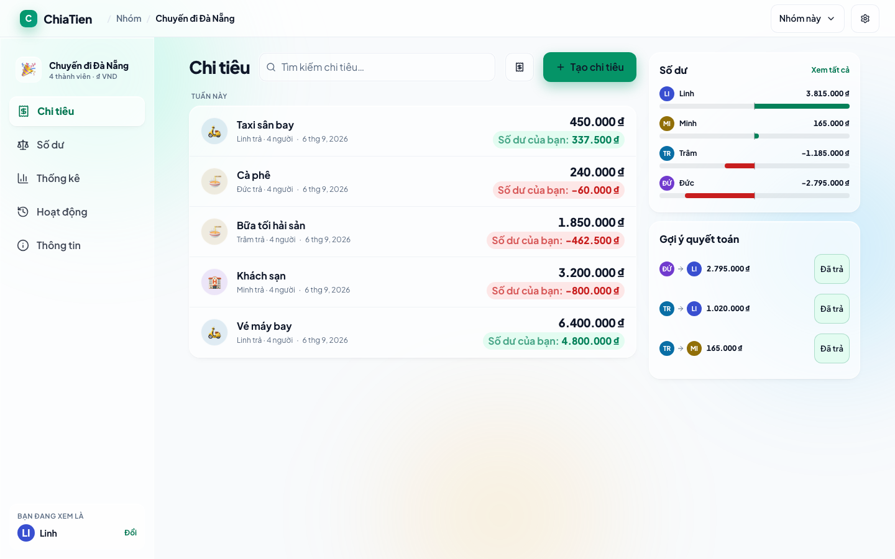
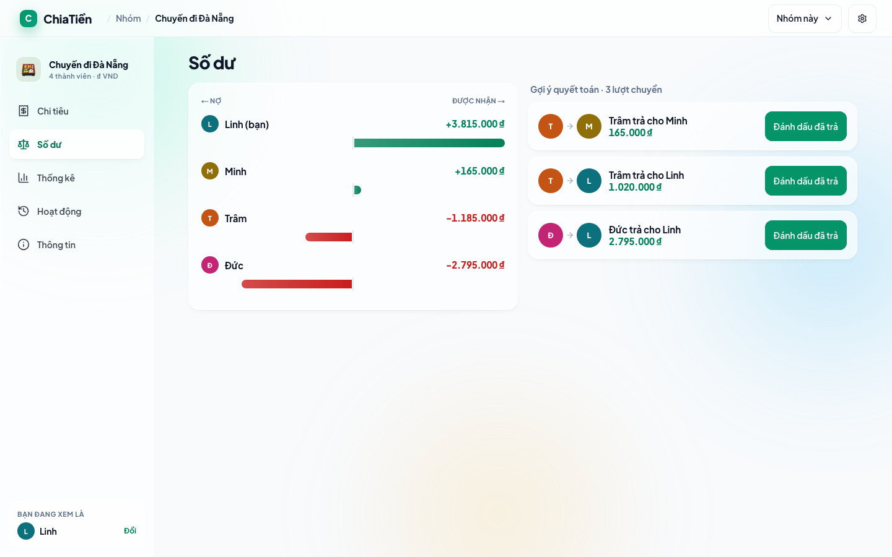
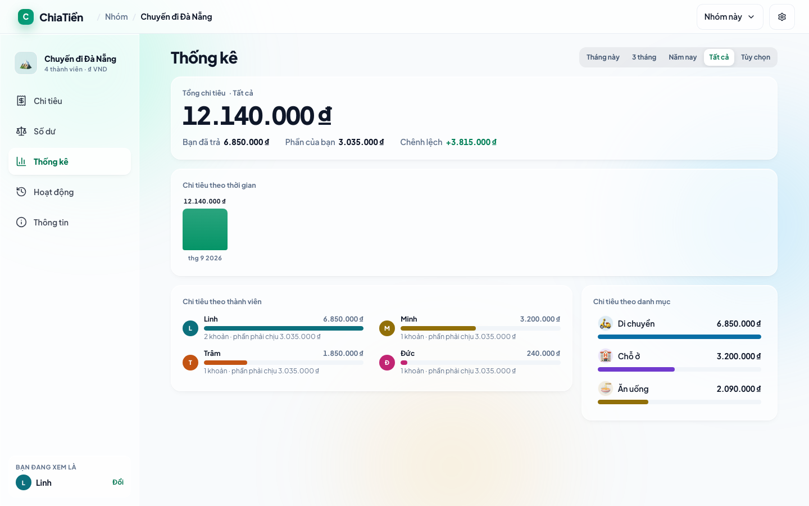
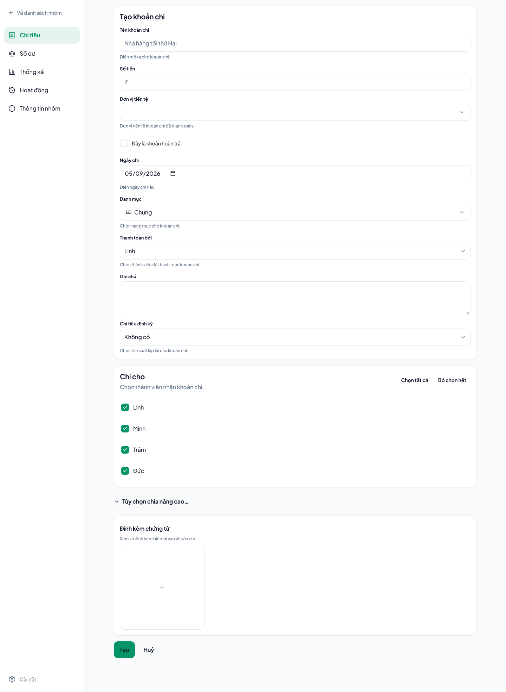
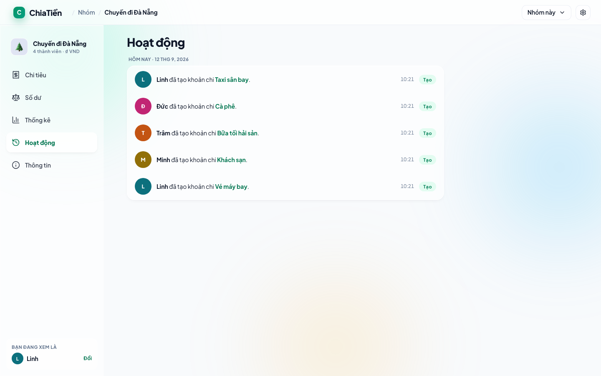
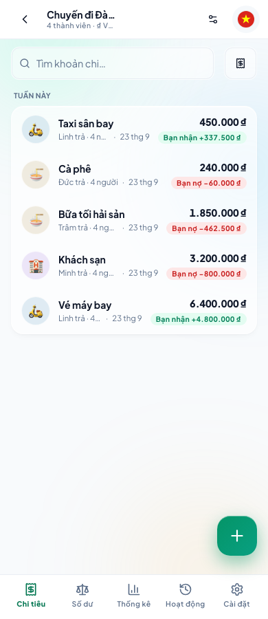
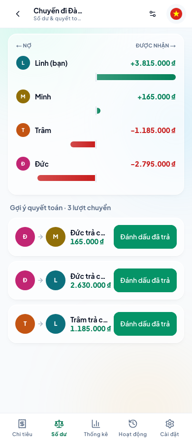
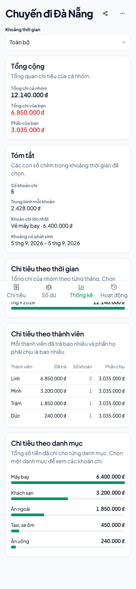

<div align="center">

# ChiaTiền

**Split group expenses without the arithmetic or the awkwardness.**

A self-hosted expense splitter with a Vietnamese-first interface. Create a group,
share its link, log who paid for what, and get the shortest set of transfers that
settles every debt.

[](https://github.com/lv-tinh-25/chiatien/actions/workflows/ci.yml)
[](LICENSE)


[](https://vercel.com/new/clone?repository-url=https%3A%2F%2Fgithub.com%2Flv-tinh-25%2Fchiatien&env=POSTGRES_PRISMA_URL,POSTGRES_URL_NON_POOLING,BASE_URL&envDescription=Two%20Postgres%20connection%20strings%20and%20the%20public%20URL&envLink=https%3A%2F%2Fgithub.com%2Flv-tinh-25%2Fchiatien%23deploying)



</div>

## Why ChiaTiền

- **No accounts.** A group lives at its URL. Share the link or the QR code and
  everyone is in; each browser remembers the groups it has opened.
- **Every way people actually split.** Evenly, by shares, by percentage or by exact
  amount, per expense.
- **Fewest transfers to settle.** Balances collapse into a minimal list of who pays
  whom, and marking one as paid records the reimbursement for you.
- **Built for Vietnamese.** Vietnamese is the default language with VND formatting
  throughout; English is a full alternative.
- **Yours to host.** One Next.js app and one PostgreSQL database. Runs free on
  Vercel and Neon.

## Screenshots

<table>
  <tr>
    <td align="center"><br><sub>Balances and settlements</sub></td>
    <td align="center"><br><sub>Statistics with drill-down</sub></td>
  </tr>
  <tr>
    <td align="center"><br><sub>Adding an expense</sub></td>
    <td align="center"><br><sub>Activity log</sub></td>
  </tr>
</table>

<p align="center">
  
  
  
</p>

## Features

- Groups shared by URL and QR code
- Even, shares, percentage and amount splits
- One currency per group, locked once the group holds expenses
- Recurring expenses
- Reimbursements prefilled from the settlement suggestions
- Income recorded as a negative expense
- Statistics by participant, category and month
- Activity log of every change
- CSV and JSON export
- Installable PWA with an offline page
- Optional: receipt attachments (S3), receipt scanning and category suggestion
  (OpenAI)

## Tech stack

| Layer     | Choice                                                          |
| --------- | --------------------------------------------------------------- |
| Framework | Next.js 16 (App Router), React 19, TypeScript                   |
| API       | tRPC 11, TanStack Query, Zod                                    |
| Data      | PostgreSQL 16, Prisma 7                                         |
| UI        | Tailwind CSS 4, Radix UI, Vaul, cmdk, Plus Jakarta Sans         |
| i18n      | next-intl — Vietnamese by default, English fallback             |
| Testing   | Jest (domain logic), Playwright (end to end), Storybook (UI)    |

## Getting started

Requirements: Node 24 (pinned in `.nvmrc`) and PostgreSQL 16.

```bash
git clone https://github.com/lv-tinh-25/chiatien.git
cd chiatien
nvm use
npm install          # also generates the Prisma client
createdb chiatien
cp .env.example .env # point POSTGRES_* at your database
npm run db:migrate
npm run dev
```

Open http://localhost:3000.

## Configuration

| Variable                   | Required | Purpose                                                    |
| -------------------------- | -------- | ---------------------------------------------------------- |
| `POSTGRES_PRISMA_URL`      | yes      | Connection the app queries through (pooled in production)  |
| `POSTGRES_URL_NON_POOLING` | yes      | Direct connection used by migrations                       |
| `BASE_URL`                 | deployed | Public address put in share links and QR codes             |
| `DEFAULT_CURRENCY_CODE`    | no       | Currency preselected for a new group (`VND`)               |

The rest of `.env.example` is opt-in. `ENABLE_EXPENSE_DOCUMENTS` with the `S3_*`
variables enables receipt attachments; `ENABLE_RECEIPT_EXTRACT` and
`ENABLE_CATEGORY_EXTRACT` with `OPENAI_API_KEY` enable the two AI features. Every
flag is off by default and enforced on the server as well as in the interface.

## Deploying

The cheapest setup is Vercel's Hobby plan with a Neon free database; neither costs
anything at this scale.

1. **Database.** Create a Neon project and copy two connection strings: the
   pooled one (host contains `-pooler`) and the direct one.
2. **Project.** Import this repository on Vercel, or use the button at the top.
3. **Environment.** Set `POSTGRES_PRISMA_URL` to the pooled string,
   `POSTGRES_URL_NON_POOLING` to the direct one, and `BASE_URL` to the production
   domain, such as `https://chiatien.vercel.app`.
4. **Deploy.** `vercel.json` runs `prisma migrate deploy` before every production
   build, so the schema is created on the first deploy and kept current after.

`BASE_URL` matters: without it, share links fall back to the per-deployment URL,
which Vercel's deployment protection puts behind a login.

Preview deployments skip migrations so a pull request cannot alter the production
schema.

## Development

```bash
npm test              # Jest, covering src/lib
npm run check-types   # tsc --noEmit
npm run lint          # ESLint
npm run build         # e2e serves this build, so build first
npm run e2e           # Playwright
npm run storybook     # component states

# Regenerate docs/screenshots after a visual change
npx playwright test --config playwright.screenshots.config.ts
```

CI runs lint, type checking and unit tests on every pull request and on every push
to `main`.

[`CLAUDE.md`](CLAUDE.md) holds the working rules: what is ported and must stay
unchanged, the typing and comment policy, the colour-token rule, and the branch and
commit conventions. `docs/superpowers/specs/` holds the design specification and
`docs/superpowers/plans/` the implementation plans.

## Credits

The database schema, split algorithms, settlement suggestions and API are ported
from [spliit](https://github.com/spliit-app/spliit). The interface is written from
scratch.

## License

[MIT](LICENSE), as is spliit.
